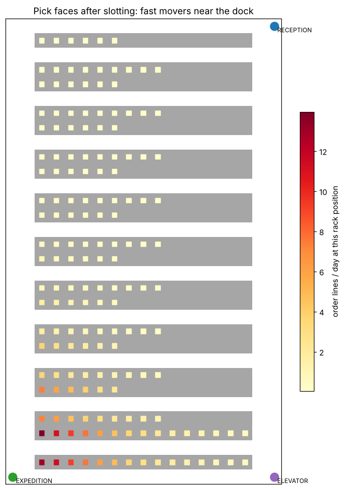
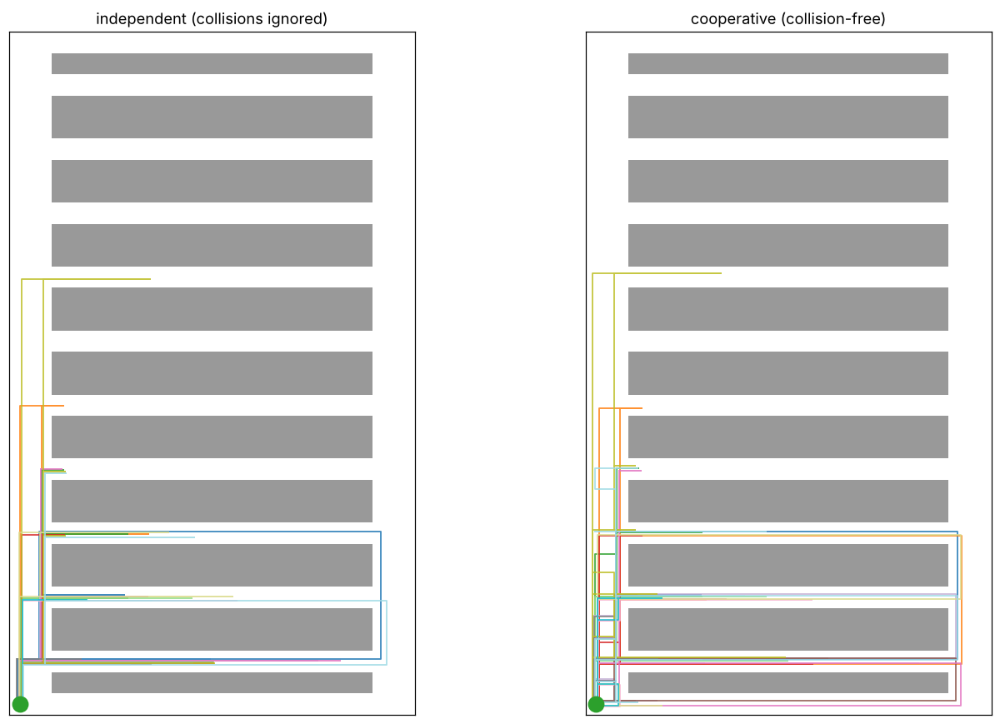
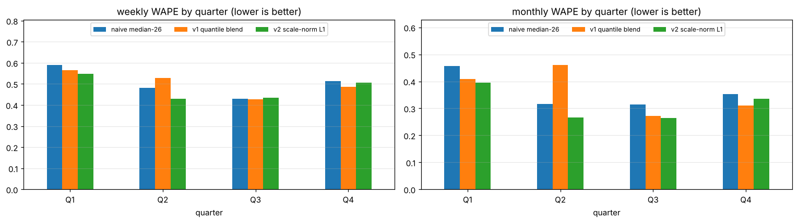

# MobAI — Warehouse Optimisation & Demand Forecasting

Team project for the **MobAI hackathon** (WMS track): **1st place in the AI track, 2nd overall**.

The project works on a real distribution warehouse (around 830 storage locations, 1,100 products, two years of orders).
It answers three operational questions:
- where to store incoming pallets;
- where to put each product on the picking racks;
- how several picking trolleys can move through narrow aisles without colliding.

A weekly demand forecast feeds all three.

```
demand forecast → product turnover → A. pallet placement
                                   → B. pick-face slotting
next-day preparation orders        → C. collision-free trolley routes
```

---

## Optimisation ([`mobai_optimisation.ipynb`](mobai_optimisation.ipynb), [`mobai_opt.py`](mobai_opt.py))

The real location codes (picking `<level><row>-<bay>-<pos>`, reserve `B07-N<floor>-<row><slot>`) are decoded and placed on a schematic grid (1 cell ≈ 1 m). The data does not include coordinates.

### A. Inbound placement: receipt → reserve
Each pallet *p* placed in slot *c* costs:

`score(p,c) = f_p · (α·d_exp(c) + β·d_rec(c) + γ·d_elev(c)) + δ · bulk_p · floor(c)`

- *f* is the pallet's weekly turnover, derived from demand.
- *d* are normalised distances; upper floors are reached through the elevator.
- *bulk* keeps large pallets on low floors.

The assignment is then solved exactly with the **Hungarian algorithm**.

| Strategy | Placement score | Weekly travel |
|---|---|---|
| Random free slot | baseline | baseline |
| Greedy, arrival order | −4 % | −2 % |
| Greedy, fastest movers first | −14 % | **−28 %** |
| **Optimal assignment (Hungarian)** | **−32 %** | −23 % |

Greedy placement without sorting is barely better than random. Ordering receipts by turnover cuts travel by more than a quarter. The exact assignment gives the best overall score: it trades a little travel to keep bulky pallets on the lowest floors.

### B. Pick-face slotting
- There are 660 picking positions. The cost of one order line is 2 × walking distance + reach time for the rack level.
- Giving the most frequent products the cheapest positions is provably optimal for this cost (rearrangement inequality).
- **Result: −50 % daily picking travel** compared with random slotting.



### C. Multi-trolley routing: A* with space-time reservations
- **Scenario:** the busiest real day is replayed with 16 orders and 111 pick lines, one trolley per order, released two time steps apart.
- **Tour order:** each trolley visits its pick faces in nearest-neighbour order.
- **Paths:** paths are computed with **A\* in space-time**. Every planned trolley reserves its *(cell, time)* cells and edges, and later trolleys plan around them, waiting if needed.

| Planner | Time steps | Makespan | Collisions |
|---|---|---|---|
| Independent A*, order-line sequence | 1,048 | 154 | 201 |
| Independent A*, nearest-neighbour tours | 746 | 122 | 127 |
| **Cooperative A* with reservations** | 1,180 | 184 | **0** |

Planning trolleys one by one looks faster on paper, but the plan is full of collisions in one-trolley-wide aisles. The reservation planner is collision-free by construction. The extra time is the real cost of congestion on a busy day.



---

## Demand forecasting ([`mobai_forecasting.ipynb`](mobai_forecasting.ipynb))

- **Data:** about 151k order lines (Jan 2024 → Jan 2026). About 320 active products make up 96 % of the volume.
- **Weekly level:** forecasts are made per week because daily demand per product is mostly zeros with no autocorrelation.
- **Features:** every feature is leak-audited (lags, rolling statistics, category trends, Ramadan/Eid calendar). Delivery logs are excluded because they *follow* demand.
- **v2 model:** LightGBM trained on demand divided by each product's recent level, with the level as sample weight. This optimises WAPE directly.
- **Evaluation:** a rolling-origin backtest over four quarters.

| Model (4-quarter average) | Weekly WAPE | Monthly WAPE | Bias |
|---|---|---|---|
| Naive: median of the last 26 weeks | 0.504 | 0.360 | −0.14 |
| v1: quantile LightGBM blend (competition) | 0.501 | 0.363 | −0.17 |
| **v2: scale-normalised L1 LightGBM** | **0.479** | **0.316** | **−0.08** |

For the top 100 products (88 % of volume), v2's weekly WAPE is 0.44.



---

## Run
```bash
pip install -r requirements.txt
# put WMS_Hackathon_DataPack_Templates_FR_FV_B7_ONLY.xlsx next to the notebooks
jupyter notebook
```
The dataset belongs to the hackathon organisers and is **not included**.

## Limits and next steps
- The geometry is schematic: real aisle widths and coordinates would make the distances exact.
- Pallet weights are empty in the data, so pallet volume is used as a proxy.
- Prioritised planning is fast and conflict-free but not globally optimal. Conflict-Based Search (CBS) is the next step for small fleets.

**Stack:** Python, pandas, NumPy, SciPy, LightGBM, Matplotlib
